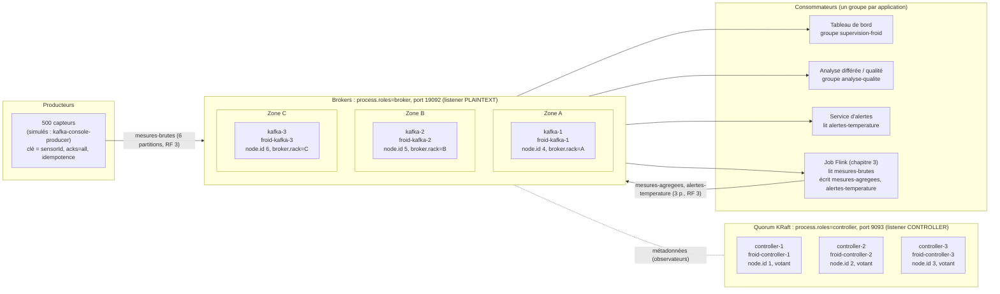

# 3. Architecture (phase B)

## 3.1 Topologie du laboratoire



Version texte, conforme au tableau « Les six nœuds » :

```
                    ┌──────────── Quorum KRaft (port 9093) ─────────────┐
                    │ controller-1 (id 1)  controller-2 (id 2)  controller-3 (id 3) │
                    │      votant               votant              votant          │
                    └───────────────▲───────────────────────────────────┘
                                    │ métadonnées (brokers = observateurs)
  ┌─────── Zone A ───────┐ ┌────── Zone B ───────┐ ┌────── Zone C ───────┐
  │ kafka-1 (id 4)        │ │ kafka-2 (id 5)       │ │ kafka-3 (id 6)       │
  │ froid-kafka-1 :19092  │ │ froid-kafka-2 :19092 │ │ froid-kafka-3 :19092 │
  │ broker.rack=A         │ │ broker.rack=B        │ │ broker.rack=C        │
  └──────────▲────────────┘ └─────────▲────────────┘ └─────────▲────────────┘
             │ produce (acks=all)      │ fetch                   │
  capteurs (clé sensorId)   supervision-froid, analyse-qualite, rejeu-incident, Flink
```

| Conteneur | Nom réseau | node.id | Rôle | Zone (`broker.rack`) | Port | Volume |
|---|---|---|---|---|---|---|
| froid-controller-1 | controller-1 | 1 | contrôleur | — | 9093 | `projet-froid_controller-1` |
| froid-controller-2 | controller-2 | 2 | contrôleur | — | 9093 | `projet-froid_controller-2` |
| froid-controller-3 | controller-3 | 3 | contrôleur | — | 9093 | `projet-froid_controller-3` |
| froid-kafka-1 | kafka-1 | 4 | broker | A | 19092 | `projet-froid_kafka-1` |
| froid-kafka-2 | kafka-2 | 5 | broker | B | 19092 | `projet-froid_kafka-2` |
| froid-kafka-3 | kafka-3 | 6 | broker | C | 19092 | `projet-froid_kafka-3` |

Aucun port n'est publié sur l'hôte : tous les clients s'exécutent dans le réseau Docker du projet (`projet-froid_default`), via `docker exec froid-kafka-1 …`.

## 3.2 Justifications

| Choix | Justification |
|---|---|
| **Rôles séparés** (`process.roles=controller` ou `broker`) | Les contrôleurs ne gèrent que les métadonnées (journal `__cluster_metadata`) et les brokers ne gèrent que les données. Une panne ou une surcharge de broker ne touche pas le quorum, ce qui est vérifié en phase G : le quorum reste disponible pendant les arrêts de brokers. C'est le mode recommandé en production. |
| **`node.id` unique dans tout le cluster** (1 à 6) | Contrôleurs et brokers partagent le même espace d'identifiants. Deux nœuds avec le même id se confondraient dans le quorum et dans les listes de répliques. |
| **Trois contrôleurs** | Le quorum Raft exige une **majorité** : avec 3 votants, la majorité est 2, donc **1 contrôleur peut tomber**. 2 contrôleurs ne tolèrent aucune panne (majorité = 2) et 4 n'en tolèrent pas plus que 3. Un seul contrôleur serait un point unique de défaillance. |
| **`broker.rack=A/B/C`** | Avec la connaissance des racks, Kafka place les 3 répliques d'une partition dans 3 zones différentes. La perte d'une zone entière ne fait perdre qu'une réplique, et l'ISR reste à 2 ≥ `min.insync.replicas`. |
| **Listeners** | Contrôleurs : `CONTROLLER://controller-N:9093`. Brokers : `PLAINTEXT://kafka-N:19092`, annoncé à l'identique dans `advertised.listeners`, car les clients sont dans le même réseau Docker. Le broker joint le quorum via `controller.quorum.bootstrap.servers` et le listener `CONTROLLER`. |
| **Formatage explicite** | Contrôleurs : `--initial-controllers` (id@hôte:port:UUID de répertoire) fige le quorum dynamique. Brokers : `--no-initial-controllers`. `--ignore-formatted` rend l'opération idempotente aux redémarrages. |
| **6 partitions pour `mesures-brutes`** | Elles répartissent 2 leaders par broker et permettent 6 consommateurs parallèles par groupe. Le débit cible (0,2 Mo/s) est très en dessous de la capacité d'une seule partition, donc le nombre est dicté par le parallélisme et l'équilibrage, pas par le volume. |
| **3 partitions pour les flux de sortie** | Débit bien plus faible (agrégats, alertes rares), 1 leader par broker. La clé reste `sensorId` pour garder l'ordre par capteur. |
| **RF = 3, `min.insync.replicas=2`, `acks=all`** | Un message confirmé existe au moins sur 2 brokers. Le cluster tolère la perte d'un broker sans refuser d'écrire, et refuse d'écrire plutôt que de perdre quand 2 brokers manquent. |
| **`unclean.leader.election.enable=false`** | Une réplique hors ISR ne peut pas devenir leader : on préfère l'indisponibilité à la perte de messages confirmés. |

## 3.3 Ce qui change en production

| Domaine | Laboratoire | Production |
|---|---|---|
| Hôtes et zones | 6 conteneurs sur 1 PC, zones simulées par `broker.rack` | 3 brokers sur 3 hôtes dans 3 zones physiques (alimentation, réseau, salle). Contrôleurs sur 3 hôtes distincts, si possible un par zone. |
| Stockage | Volumes nommés Docker sur le disque système | Disques dédiés (SSD/NVMe) par broker, ≈ 80 Go chacun d'après le calcul, système de fichiers XFS/ext4, supervision de l'espace |
| Ressources | Heap de 512 Mo | Heap de 4 à 6 Go, plus beaucoup de RAM libre pour le cache de pages. CPU dimensionné pour TLS et la compression. |
| Sécurité | PLAINTEXT, sans authentification | TLS sur tous les listeners (clients, inter-brokers, contrôleurs), SASL (SCRAM ou OAUTHBEARER), ACL par application, secrets hors du dépôt |
| Réseau | Réseau bridge Docker | Réseau dédié et segmenté. Contrôleurs non joignables par les clients. Pare-feu limité aux ports 9093/9094. `advertised.listeners` résolvables par les clients. |
| Supervision | Commandes manuelles | Exporteur JMX vers Prometheus et Grafana, alertes sur URP, UnderMinIsr, Offline, ActiveController, lag, disque (voir `06`) |
| Sauvegardes | Aucune | Réplication vers un second cluster (MirrorMaker 2) et/ou archivage dans un stockage objet, sauvegarde des configurations et des identifiants (`CLUSTER_ID`, UUID) |
| Exploitation | Démarrages manuels | Redémarrages progressifs (rolling), procédures écrites, mises à jour testées en préproduction, gestion de la configuration (Ansible, Kubernetes avec Strimzi) |
